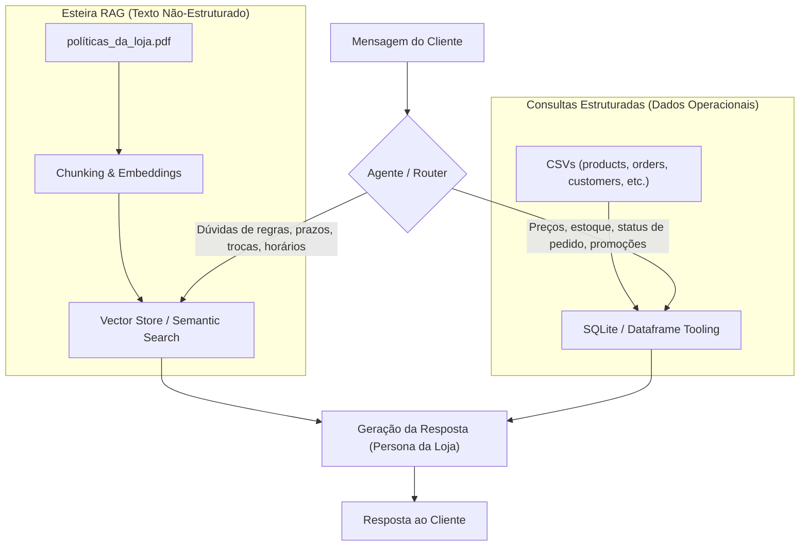

# Mapeamento de Ativos e Fontes de Dados — Esteira RAG

Este documento mapeia todos os arquivos de dados fornecidos para o desenvolvimento do agente de atendimento da **Empório da Música**, registrando seus caminhos, extensões, tamanhos e categorização técnica para a esteira de ingestão e retrieval (RAG / Tool Calling).

---

## 📂 Diretório Raiz de Dados

- **Caminho Absoluto:** `E:\@Vault\[01] Conhecimento & Carreira\Portfolio & CV\Artefact\data`
- **Caminho Relativo:** `data/`

---

## 🗺️ Inventário e Mapeamento de Arquivos

| # | Nome do Arquivo | Formato | Tamanho (Bytes) | Natureza do Dado | Papel na Arquitetura |
|---|-----------------|:-------:|:---------------:|:----------------:|:---------------------|
| 1 | `políticas_da_loja.pdf` | `.pdf` | 180.519 B (~180 KB) | Não-Estruturado (Manual/Texto) | **Esteira RAG / Vetorial:** Ingestão, chunking e busca semântica para dúvidas de políticas (trocas, devoluções, prazos, horários, pagamentos). |
| 2 | `desafio_tecnico_ai_eng - categories.csv` | `.csv` | 756 B | Estruturado (Tabela) | **Catálogo:** Categorias de instrumentos e acessórios (suporte a filtros de busca e taxonomia). |
| 3 | `desafio_tecnico_ai_eng - products.csv` | `.csv` | 22.399 B (~22 KB) | Estruturado (Tabela) | **Catálogo & Estoque:** Produtos, especificações, modelos, disponibilidade e preços. |
| 4 | `desafio_tecnico_ai_eng - promotions.csv` | `.csv` | 839 B | Estruturado (Tabela) | **Comercial:** Promoções ativas, cupons, descontos e vigência. |
| 5 | `desafio_tecnico_ai_eng - customers.csv` | `.csv` | 3.756 B (~3.7 KB) | Estruturado (Tabela) | **CRM / Clientes:** Identificação de clientes, contatos e histórico cadastral. |
| 6 | `desafio_tecnico_ai_eng - orders.csv` | `.csv` | 1.324 B (~1.3 KB) | Estruturado (Tabela) | **Operação / Vendas:** Status de pedidos, datas de compra e rastreio. |
| 7 | `desafio_tecnico_ai_eng - order_items.csv` | `.csv` | 230 B | Estruturado (Tabela) | **Operação / Vendas:** Itens vinculados aos pedidos (relação pedido x produto). |

---

## 📍 Localização Completa por Arquivo

1. **Manual de Políticas da Loja:**
   - **Arquivo:** `políticas_da_loja.pdf`
   - **URI / Caminho:** [políticas_da_loja.pdf](file:///E:/@Vault/[01]%20Conhecimento%20&%20Carreira/Portfolio%20&%20CV/Artefact/data/pol%C3%ADticas_da_loja.pdf)

2. **Categorias de Produtos:**
   - **Arquivo:** `desafio_tecnico_ai_eng - categories.csv`
   - **URI / Caminho:** [categories.csv](file:///E:/@Vault/[01]%20Conhecimento%20&%20Carreira/Portfolio%20&%20CV/Artefact/data/desafio_tecnico_ai_eng%20-%20categories.csv)

3. **Produtos e Catálogo:**
   - **Arquivo:** `desafio_tecnico_ai_eng - products.csv`
   - **URI / Caminho:** [products.csv](file:///E:/@Vault/[01]%20Conhecimento%20&%20Carreira/Portfolio%20&%20CV/Artefact/data/desafio_tecnico_ai_eng%20-%20products.csv)

4. **Promoções:**
   - **Arquivo:** `desafio_tecnico_ai_eng - promotions.csv`
   - **URI / Caminho:** [promotions.csv](file:///E:/@Vault/[01]%20Conhecimento%20&%20Carreira/Portfolio%20&%20CV/Artefact/data/desafio_tecnico_ai_eng%20-%20promotions.csv)

5. **Clientes:**
   - **Arquivo:** `desafio_tecnico_ai_eng - customers.csv`
   - **URI / Caminho:** [customers.csv](file:///E:/@Vault/[01]%20Conhecimento%20&%20Carreira/Portfolio%20&%20CV/Artefact/data/desafio_tecnico_ai_eng%20-%20customers.csv)

6. **Pedidos:**
   - **Arquivo:** `desafio_tecnico_ai_eng - orders.csv`
   - **URI / Caminho:** [orders.csv](file:///E:/@Vault/[01]%20Conhecimento%20&%20Carreira/Portfolio%20&%20CV/Artefact/data/desafio_tecnico_ai_eng%20-%20orders.csv)

7. **Itens dos Pedidos:**
   - **Arquivo:** `desafio_tecnico_ai_eng - order_items.csv`
   - **URI / Caminho:** [order_items.csv](file:///E:/@Vault/[01]%20Conhecimento%20&%20Carreira/Portfolio%20&%20CV/Artefact/data/desafio_tecnico_ai_eng%20-%20order_items.csv)

---

## 🏗️ Estratégia de Ingestão e Roteamento Arquitetural

> **Nota:** Todos os arquivos foram apenas indexados e mapeados por caminhos e metadados, sem leitura de conteúdo, preservando-os para o pipeline de processamento e ingestão.
