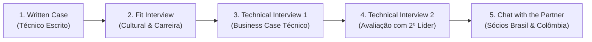

# Processo Seletivo Artefact — AI Engineer

Documento de consolidação das diretrizes, prazos, etapas e requisitos do processo seletivo recebido via e-mail para a posição na **Artefact**.

---

## 📌 Visão Geral da Vaga

- **Empresa:** [Artefact](https://www.artefact.com/) (Consultoria global de dados, IA e transformação digital)
- **Cargo:** `AI Engineer – Full-Stack para Aplicações com IA Generativa`
- **Escritório:** São Paulo/SP (Brasil)
- **Modelo de Trabalho:** Full Home Office (100% Remoto)
- **Candidato:** Felipe Barros (`felipe.barros.ia@gmail.com`)
- **LinkedIn:** [Perfil LinkedIn](https://www.linkedin.com/in/felipe-barros-ai/)

---

## 🗺️ Etapas do Processo Seletivo (5 Fases)

Cada fase é eliminatória e condicionada à aprovação na etapa anterior:



1. **Etapa 1 — Written Case (Fase Atual):**
   - Resolução de um case técnico focado em raciocínio lógico e soluções diretas/eficientes.
   - Entrega via Google Forms com upload de PDF.
2. **Etapa 2 — Fit Interview:**
   - Entrevista de alinhamento comportamental/cultural e apresentação aprofundada da Artefact.
3. **Etapa 3 — Technical Interview 1:**
   - Entrevista técnica para avaliação de capacidade analítica, comunicação e resolução de problemas através de um *business case*.
4. **Etapa 4 — Technical Interview 2:**
   - Similar à primeira etapa técnica, conduzida por outro entrevistador técnico.
5. **Etapa 5 — Chat with the Partner:**
   - Alinhamento estratégico e conversa final com os *Partners* da Artefact no Brasil e na Colômbia.

---

## 📝 Diretrizes da Etapa 1: Written Case

### 1. Prazos e Cronograma
- **Início oficial:** 31 de Outubro de 2026.
- **Prazo limite:** Até o final do **segundo dia útil** a partir da data de abertura (23:59).
  > **Nota de Planejamento:** Como o envio ocorreu no fim de semana/sábado (31/10), o objetivo é concluir e validar a solução com antecedência para envio seguro.

### 2. Regras Críticas de Execução e Entrega
- **Idioma Obrigatório:** **Inglês** (*"All responses must be in English!"*).
- **Formato do Arquivo:** Exclusivamente **`.pdf`**.
- **Padrão Obrigatório de Nomenclatura:**
  ```text
  [Your Name] - [Career]
  ```
  **Nome exato do arquivo para este processo:**
  ```text
  Felipe Barros - AI Engineer – Full-Stack para Aplicações com IA Generativa.pdf
  ```
- **Princípio de Resolução:** Avaliação centrada em **raciocínio lógico**, resolvendo o problema da **forma mais simples e elegante possível** (*"solve it in the simplest way possible"*).

### 3. Canal de Submissão
- **Formulário de Entrega:** [Google Forms — Submissão do Case](https://docs.google.com/forms/d/e/1FAIpQLSfoBG7mylEyrki5DtJ3BSgb_Iiz3MFe84iGfI7AM0NqhFfCLg/viewform?usp=pp_url&entry.985838347=felipe.barros.ia@gmail.com&entry.1255402597=AI+Engineer+-+Brazil&entry.1211545926=https://www.linkedin.com/in/felipe-barros-ai/&entry.850837632=https://app2.greenhouse.io/people/287179157002?application_id=302751012002)
- **Requisito Técnico:** Estar logado em uma conta Google/Gmail para permitir o upload do arquivo.

---

## ✅ Checklist de Conformidade da Etapa 1

- [ ] Arquivo de enunciado do case (PDFs) recebido e analisado
- [ ] Raciocínio lógico e arquitetura da solução estruturados
- [ ] Implementação técnica e justificativas desenvolvidas
- [ ] Documento redigido 100% em **inglês**
- [ ] Exportação do documento final em formato **PDF**
- [ ] Validação do nome do arquivo: `Felipe Barros - AI Engineer – Full-Stack para Aplicações com IA Generativa.pdf`
- [ ] Submissão no Google Forms dentro do prazo estabelecido

---

## 🔗 Links e Materiais de Apoio

- **Website Artefact:** [artefact.com](https://www.artefact.com/)
- **Podcast Oficial:** [Artefact no Spotify](https://open.spotify.com/show/35FNLoQuXKyme6SsJ9PssZ?si=d4085e7b4592428b)
- **Formulário de Submissão:** [Google Forms Pré-Preenchido](https://docs.google.com/forms/d/e/1FAIpQLSfoBG7mylEyrki5DtJ3BSgb_Iiz3MFe84iGfI7AM0NqhFfCLg/viewform?usp=pp_url&entry.985838347=felipe.barros.ia@gmail.com&entry.1255402597=AI+Engineer+-+Brazil&entry.1211545926=https://www.linkedin.com/in/felipe-barros-ai/&entry.850837632=https://app2.greenhouse.io/people/287179157002?application_id=302751012002)
- **Registro do Candidato (Greenhouse):** [Candidatura Greenhouse](https://app2.greenhouse.io/people/287179157002?application_id=302751012002)
