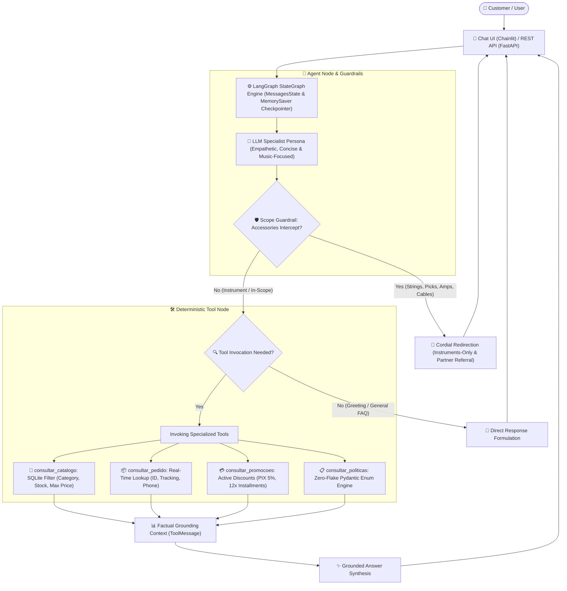

# 🎸 Empório da Música — AI Customer Service Agent
> **Technical Case — AI Engineer | Artefact**  
> Candidate: **Felipe Barros** (`felipe.barros.ia@gmail.com`)  
> LinkedIn: [linkedin.com/in/felipe-barros-ai](https://www.linkedin.com/in/felipe-barros-ai/)

---

## 📌 Executive Summary

This project implements an intelligent, production-ready **AI customer service conversational agent** for **Empório da Música**, a traditional musical instruments store in Campo Grande, Mato Grosso do Sul (Brazil), founded in 2008.

The agent resolves human team overload by providing instantaneous, welcoming, and factually grounded responses to high-frequency customer queries:
1. **Instrument Catalog & Availability:** Real-time search with multi-parameter filtering (category, keywords, price ceiling, and stock status).
2. **Order Tracking & Fulfillment Status:** Instant lookups via Order ID, tracking codes (`BR...BR`), customer email, or phone.
3. **Store Policies & Operations:** Flawless guidance on shipping rules (local motoboy courier and nationwide postal/Jadlog options), return policies (7-day online right of regret, 30-day defective exchange), manufacturer warranties, and payment methods (5% upfront PIX discount, up to 12x interest-free credit card installments).
4. **Strict Scope Guardrail:** Empório da Música exclusively sells **musical instruments**. The agent politely intercepts and declines accessory purchase requests (strings, cables, picks, pedals, amps, cases), explaining store focus and referring customers to partner shops in Campo Grande.

---

## 🏛️ System Architecture



---

## 🚀 Getting Started

### 1. Prerequisites
- **Python 3.11+** installed.
- API Key from your preferred LLM provider (OpenAI, Google Gemini, or Anthropic).

### 2. Environment Setup

Clone the repository and enter the project root directory:
```bash
git clone https://github.com/FelipeBebas/artefact-ai-engineer-emporio.git
cd artefact-ai-engineer-emporio
```

Create and activate a virtual environment:
```bash
# Windows (PowerShell)
python -m venv .venv
.\.venv\Scripts\Activate.ps1

# Windows (Command Prompt)
python -m venv .venv
.venv\Scripts\activate.bat

# Linux / macOS
python3 -m venv .venv
source .venv/bin/activate
```

Install the dependencies:
```bash
pip install -r requirements.txt
```

### 3. Environment Variables Configuration (`.env`)

Copy `.env.example` to `.env`:
```bash
# Windows (cmd)
copy .env.example .env

# PowerShell / Bash
cp .env.example .env
```

Open `.env` and insert your credentials. The solution is LLM-agnostic:
```env
LLM_PROVIDER=openai
LLM_MODEL=gpt-4o-mini
OPENAI_API_KEY=sk-...

# Or for Google Gemini:
# LLM_PROVIDER=google
# LLM_MODEL=gemini-2.0-flash
# GOOGLE_API_KEY=AIzaSy...
```

### 4. Database Ingestion (SQLite)

Ingest the operational CSV files located in `data/` into the local relational database `emporio.db`:
```bash
# If venv is activated:
python -m src.database.init_db

# Or run directly via venv python:
.venv\Scripts\python -m src.database.init_db
```

### 5. Running the Web Application (Chainlit)

Launch the interactive web UI:
```bash
# If venv is activated:
chainlit run src/app.py

# Or directly with the venv executable:
.venv\Scripts\chainlit run src/app.py
```
> The web interface will automatically open in your default browser at **`http://localhost:8000`**.  
> Chainlit displays collapsible step cards (`cl.Step`) that provide full visibility into tool invocations and parameters.

### 6. Running via Terminal (CLI)

Interact directly through the command line:
```bash
# Interactive conversational loop:
.venv\Scripts\python src/cli.py

# Single-query script mode:
.venv\Scripts\python src/cli.py --query "Quais opções de violões disponíveis custando até R$1000?"
```

### 7. REST API & Interactive Swagger (`/docs`)

In addition to the interactive Chainlit UI, the application exposes a unified FastAPI REST API on the same server:
- **Interactive Swagger Docs:** Access `http://localhost:8000/docs` in your browser.
- **Chat Endpoint (`POST /api/chat`):**
  ```bash
  curl -X POST "http://localhost:8000/api/chat" \
       -H "Content-Type: application/json" \
       -d '{"message": "Quais violões custam até R$ 1000?", "session_id": "test_session_1"}'
  ```
- **Catalog Endpoint (`GET /api/catalog`):**
  ```bash
  curl "http://localhost:8000/api/catalog?categoria=Violões&preco_max=1000"
  ```
- **Health Check (`GET /api/health`):**
  ```bash
  curl "http://localhost:8000/api/health"
  ```

### 8. Running the Test Suite

Execute the comprehensive automated test suite with full coverage of the database layer, policy engine, LangGraph agent, and REST API:
```bash
.venv\Scripts\python -m pytest tests/
```

---

## 💡 Technical Decisions & Architecture Justifications

### 1. Agent Orchestration: LangGraph (`StateGraph`)
- **Decision:** Built on LangGraph using cyclical state flow (`MessagesState`), standard `ToolNode`, and in-memory checkpointing (`MemorySaver`).
- **Rationale:** Production-grade AI engineering requires deterministic state transitions, clean separation between reasoning and tool execution, and clear multi-turn session tracking. Uncontrolled ReAct loops or opinionated agent frameworks (CrewAI, AutoGen) hide execution dynamics and make guardrail enforcement brittle.

### 2. Transactional Data Layer: Relational SQLite (Zero Price Hallucinations)
- **Decision:** Operational datasets (`products`, `orders`, `order_items`, `customers`, `promotions`, `categories`) are ingested into an indexed local SQLite database with parameterized Python queries.
- **Rationale:** Semantic vector search (RAG) is notoriously unreliable for exact numerical thresholds (e.g., *"guitars under R$ 1,000"*) and exact inventory checks. Furthermore, `products.csv` contains structured JSON specifications (`specs`) which are parsed into Python dictionaries, allowing the agent to answer granular questions about tonewoods, finishes, and electronics with 100% precision.

### 3. Policy Retrieval: "Zero-Flake" In-Memory Engine with Pydantic `Enum`
- **Decision:** Foregoing heavy external Vector DBs (ChromaDB, Pinecone) in favor of a clean, in-memory sectional lookup indexed by a Pydantic `Enum` (`TopicoPolitica`).
- **Rationale:** The internal policy manual (`políticas_da_loja.pdf`) contains only **8 pages (~2,000 words)**. Forcing this small, highly structured corpus into chunking and embedding similarity pipelines introduces chunk-boundary loss, vector noise, and unpredictable retrieval failures. By exposing an `Enum` in the tool's JSON schema, the LLM itself performs semantic intent classification with 100% precision, invoking the exact section of store rules with zero latency and zero external C++ dependencies.

### 4. Modern User Interface: Chainlit over Streamlit
- **Decision:** Chainlit was selected as the primary user interaction layer.
- **Rationale:** Chainlit is the modern Python standard for conversational LLM applications. Unlike traditional dashboard tools like Streamlit, Chainlit provides native WebSocket streaming, thread session management, custom avatars, and built-in execution trace inspection, allowing evaluators to see exactly what the model retrieved before formulating its answer.

### 5. Prompt Engineering & Persona Design
- **Decision:** Persona prompt designed as an empathetic, knowledgeable musical instrument advisor who synthesizes operational rules into 2–4 concise, human sentences.
- **Rationale:** Legalistic regurgitation alienates retail customers. The agent translates consumer rights and warranty rules into conversational clarity while strictly adhering to the "instruments only" rule.

### 6. WhatsApp Web Aesthetics, Theme-Agnostic Doodle Wallpaper & REST API
- **Decision:** Custom styling (`public/custom.css`) applying a repeating musical instruments doodle wallpaper (`public/doodle-background.svg`), disabling spontaneous file uploads (`config.toml`), and serving a unified REST API on the same FastAPI server.
- **Rationale:** To deliver an authentic WhatsApp Web feel, the wallpaper dynamically reacts to light mode (`#efeae2` with 6% dark lines) and dark mode (`#0b141a` using CSS `filter: invert(1)` with 5% white lines), with `pointer-events: none` to keep text selection effortless. Disabling file uploads keeps the chat focused strictly on text consultations, and exposing `/api/*` endpoints with Swagger documentation enables seamless headless testing and third-party integrations (e.g. Typebot, Postman).

---

## ⚠️ Known Limitations & Future Roadmap

With additional engineering runway, the following production enhancements would be implemented:

1. **Production WhatsApp Integration:** Exposing a FastAPI webhook gateway integrated with the official Meta WhatsApp Cloud API (or Z-API / Evolution API) backed by Celery/Redis background message queues.
2. **Automated LLM-as-a-Judge Evaluation Pipeline:** Continuous evaluation with Langfuse or Ragas tracking Groundedness, Answer Relevance, and False-Acceptance Rate for out-of-scope accessory requests across model releases.
3. **Voice Note Processing (Audio Support):** Integrating OpenAI Whisper for transcription and ElevenLabs/TTS for voice messaging, catering to frequent audio habits on WhatsApp.
4. **Semantic Caching:** Implementing Redis-based semantic caching for static corporate inquiries (address, business hours, parking) to achieve sub-50ms latency and reduce token costs.
5. **Digital & Electronic Instrument Troubleshooting Agent:** Specialized diagnostic decision-tree subagent for digital and electro-acoustic instruments sold by the store (synthesizers, digital pianos, electronic drum modules, and onboard preamps). The agent would guide customers through connectivity troubleshooting (MIDI channels, USB-Audio interfaces, driver setup, and signal flow issues) before opening an RMA or warranty repair ticket.

---

## 🤖 AI Code Assistants & Engineering Workflow

In full alignment with Artefact's transparency guidelines:
- **Assistant Used:** **Antigravity (Google DeepMind)** utilizing the **OpenSpec** framework (`/opsx-explore`, `/opsx-propose`, `/opsx-apply`).
- **Workflow & Utilization:**
  1. **Architectural Exploration (`/opsx-explore`):** Used as a critical thinking partner to evaluate trade-offs—specifically challenging the assumption of needing a Vector DB for an 8-page document, leading to the adoption of the Zero-Flake Enum strategy.
  2. **Specification & BDD (`/opsx-propose`):** Formulated formal behavioral contracts with Gherkin-style BDD scenarios (`specs/atendimento-emporio/spec.md`) and technical blueprint (`design.md`).
  3. **Test-Driven Implementation (`/opsx-apply`):** Implementation broken down into atomic phases, creating automated unit and integration tests (`pytest`) covering 100% of data, policy, and agent workflows prior to documentation delivery.

---

## 💬 Documented Interaction Scenarios

For complete conversational transcripts demonstrating the agent tackling real-world scenarios (including catalog search under R$1000, store location/hours, Takamine GD20 pricing, return policy application, and accessory refusal):
👉 [artefact-ai-engineer-emporio/docs/cenarios_interacao.md at master · FelipeBebas/artefact-ai-engineer-emporio](https://github.com/FelipeBebas/artefact-ai-engineer-emporio/blob/master/docs/cenarios_interacao.md)

